# 9.10.1 화면

번호와 저장을 먼저 보여주고 모델 비교·과거 결과·긴 설명은 펼쳐 읽도록 정리했습니다. 아래 번호는 1250회까지의 공개 자료로 계산한 화면 예시이며 실제 구매·당첨 기록이 아닙니다.

## Windows

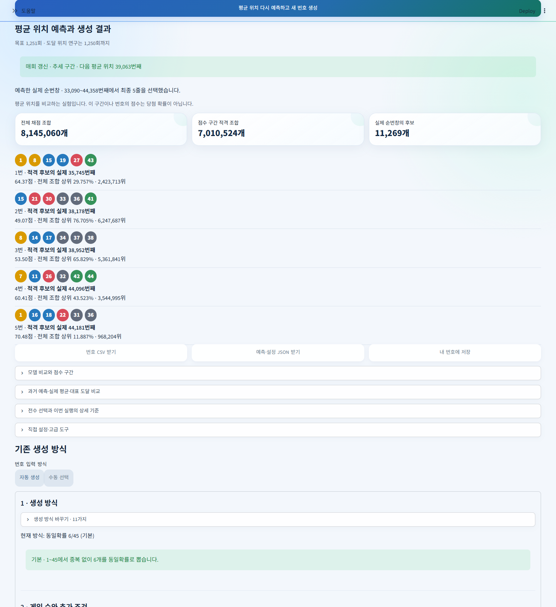

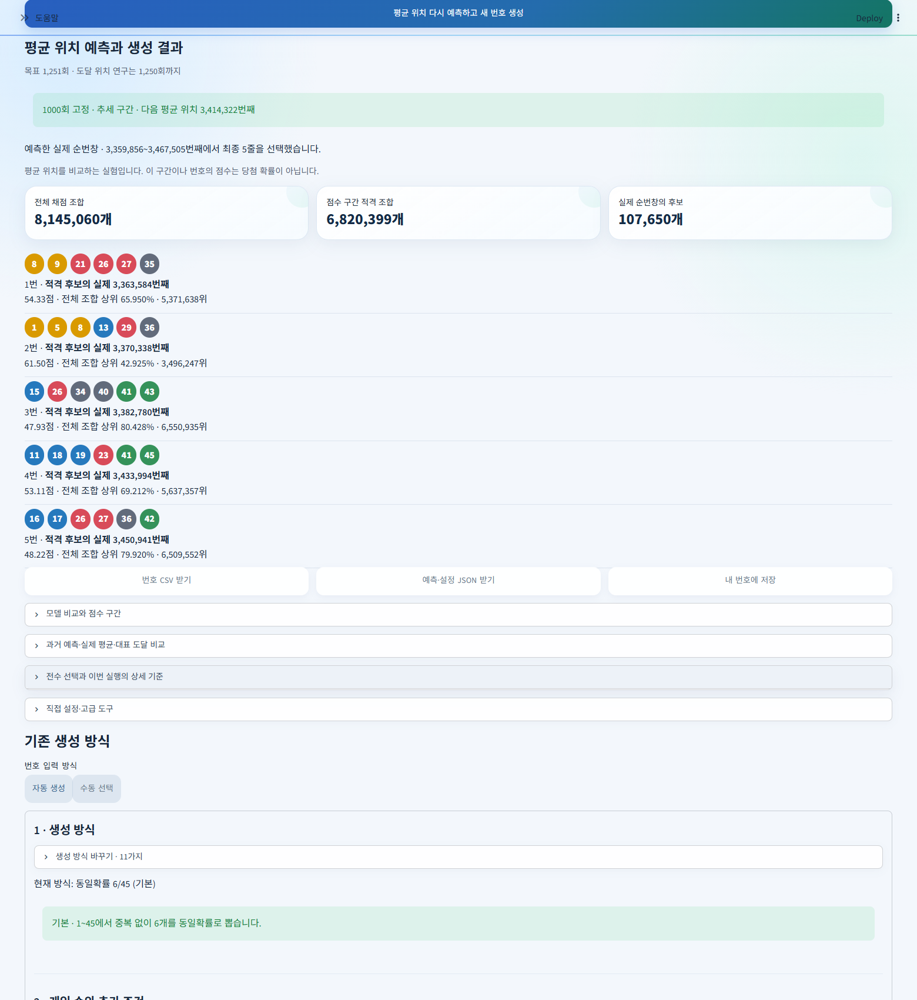

## Android 공통 화면

같은 앱 위젯을 Flutter로 렌더링한 등록정보용 화면입니다. 설치 파일의 네이티브 전체 조합 계산도 별도로 검사했습니다.

| 홈 | 분석 | 번호 생성 | 과거 검증 |
| --- | --- | --- | --- |
| 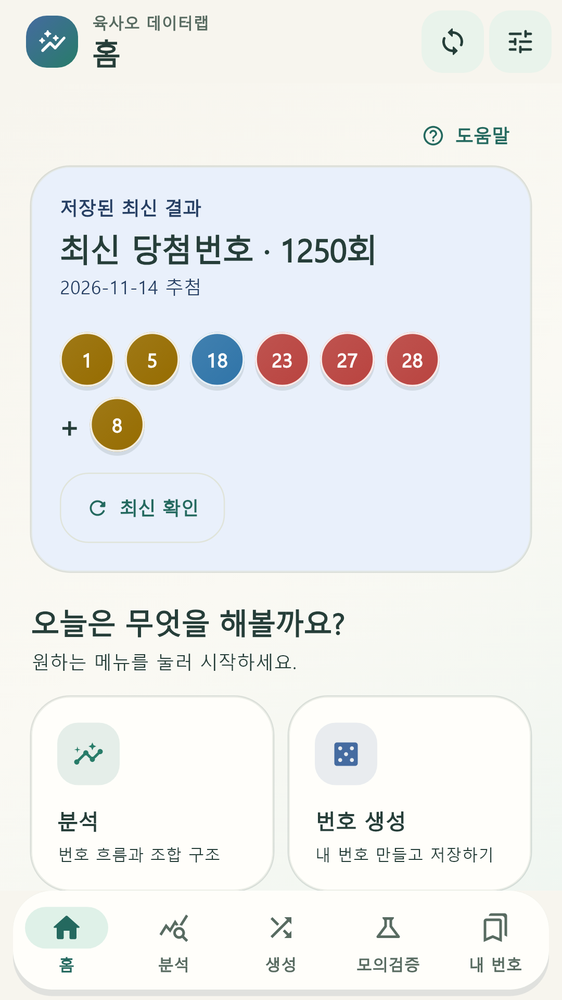 | 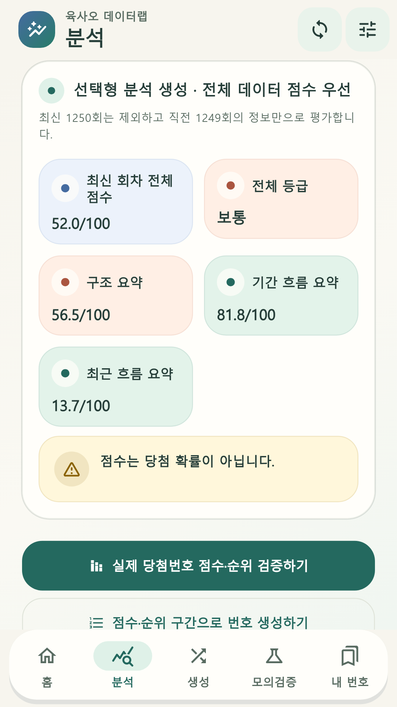 | 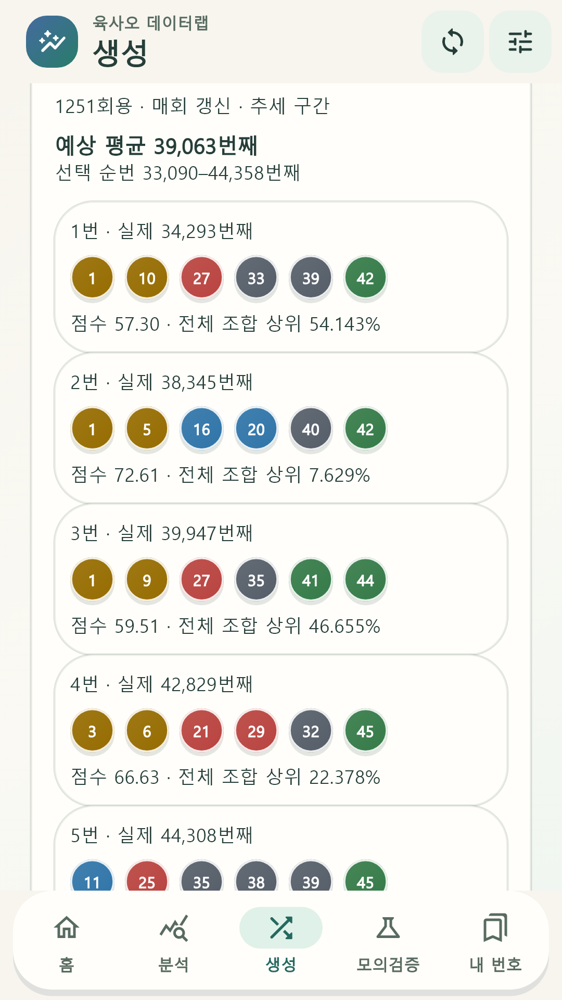 | 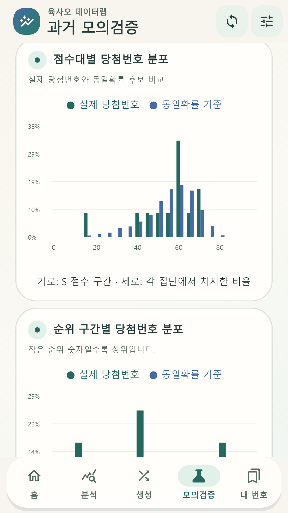 |

| 내 번호 | QR | 회차 조회 | 모델 비교 |
| --- | --- | --- | --- |
| 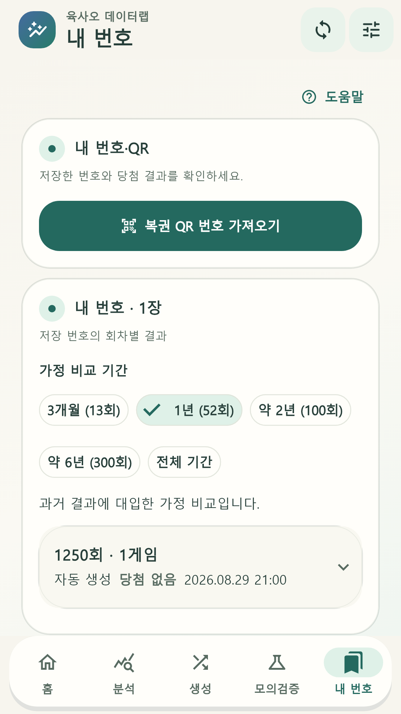 | 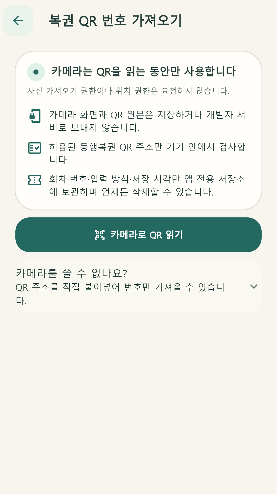 | 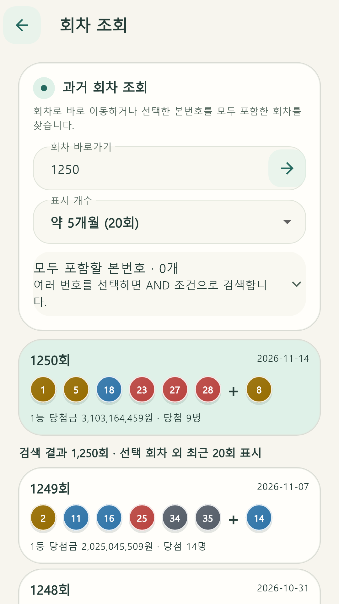 | 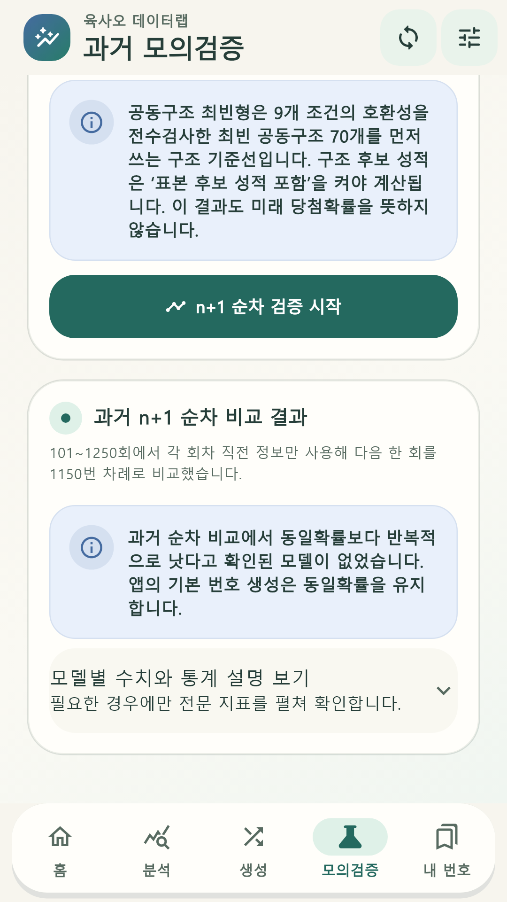 |

## iOS 준비 화면

공통 Flutter 화면을 iOS 스타일로 렌더링한 준비 자료입니다. 서명된 iPhone 앱을 촬영한 화면이나 App Store 출시 완료를 뜻하지 않습니다.

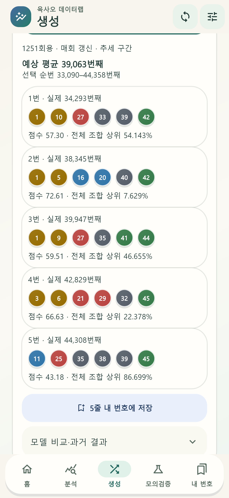

점수·평균 위치·순번 구간은 참고 정보이며 미래 당첨확률을 높이거나 당첨을 보장하지 않습니다.

## 설치한 Android 앱에서 확인

API 36 에뮬레이터에 서명된 9.10.1 APK를 설치해 실제 전수 계산·두 목표 재생성·저장을 확인했습니다. 아래는 고정 화면 자료를 주입하지 않은 실행 캡처입니다.

| 실제 1~3등 목표 생성 | 실제 1등 목표 생성 | 시스템 글씨 2배 |
| --- | --- | --- |
| 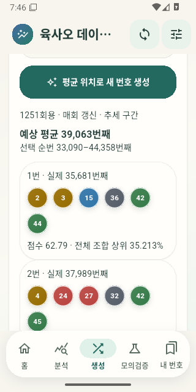 | 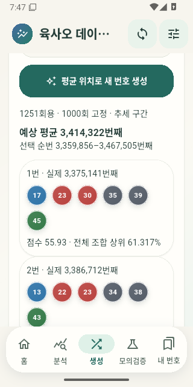 | 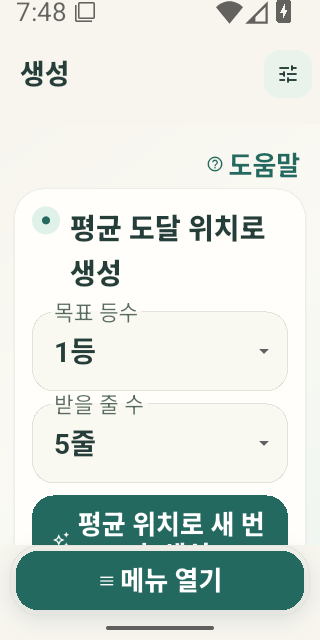 |
