# 9.9.7 화면 둘러보기

실제 Flutter 코드와 1248회까지의 공개 데이터로 렌더링한 모바일 공통 미리보기입니다. Android·iOS 실기기 촬영 사진은 아닙니다. 저장 번호와 사전 기록은 촬영용 테스트 자료이며 실제 사용자 저장소는 사용하지 않았습니다. PC는 같은 기능 구성을 다른 화면 배치로 제공합니다.

메뉴: **홈 · 분석 · 번호 생성 · 과거 모의검증 · 내 번호·QR · 설정·정보**.

## 분포·추세 선택

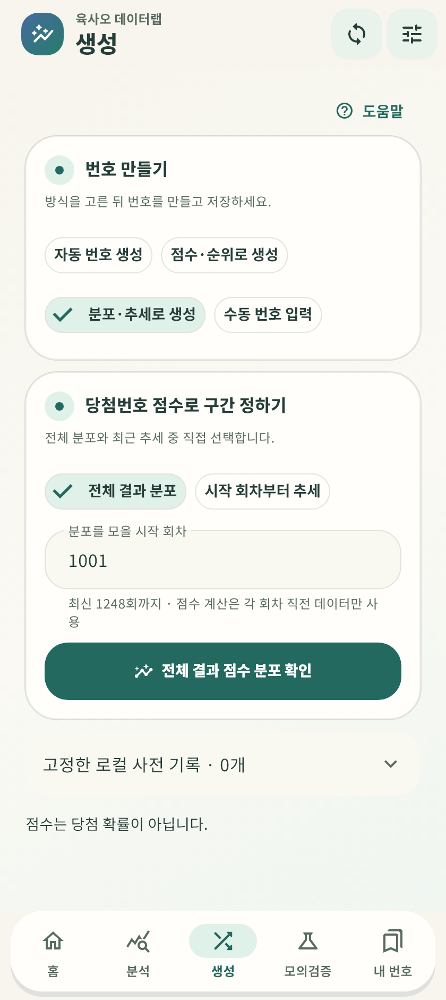

## 점수 구간과 같은 모델의 무작위 기준

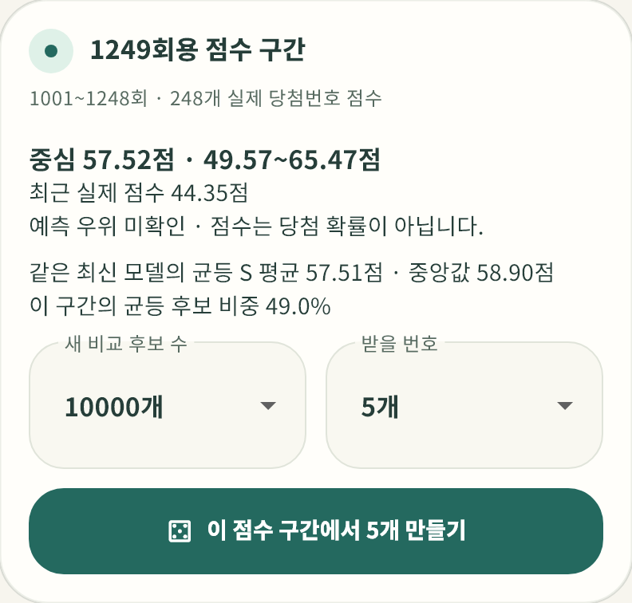

## 최종 10줄·30줄 과거 비교

아래는 1만 후보·시드 2026으로 1197~1248회 52개 목표 회차에 대해 실제로 계산한 과거 30줄 비교의 위쪽 결과입니다. 미래 당첨 우위를 입증하는 자료는 아닙니다.

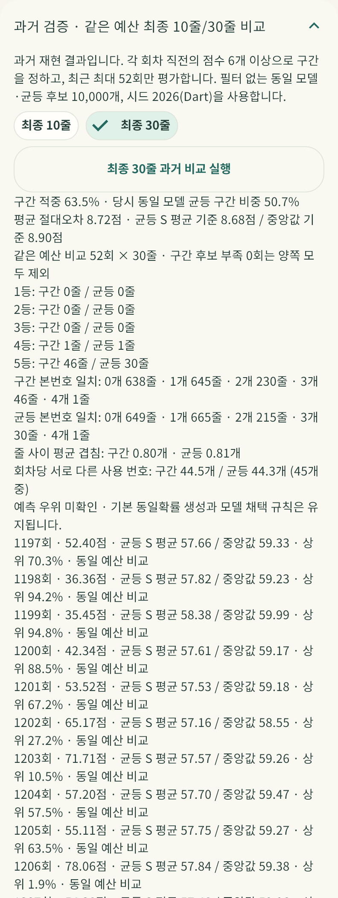

## 추첨 전 번호 고정 기록

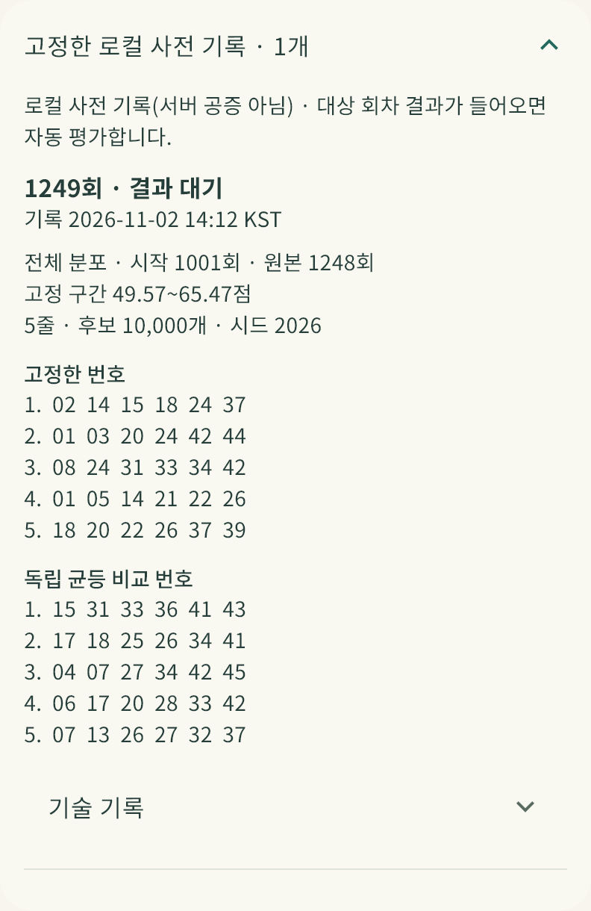

## 기본 화면

| 홈 | 분석 |
| --- | --- |
| 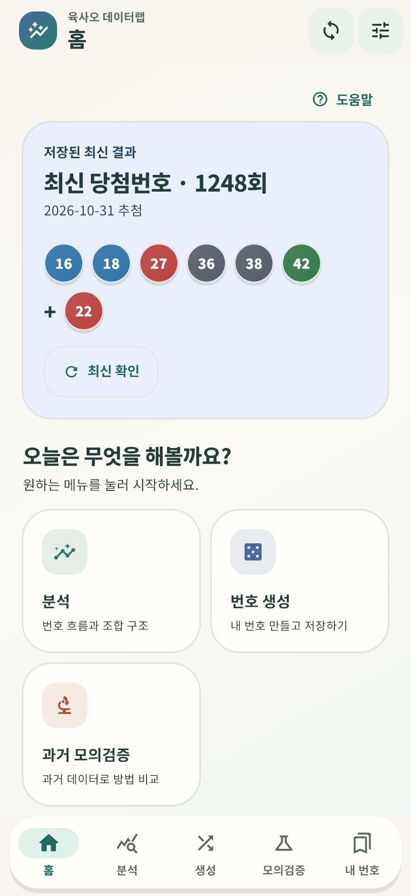 | 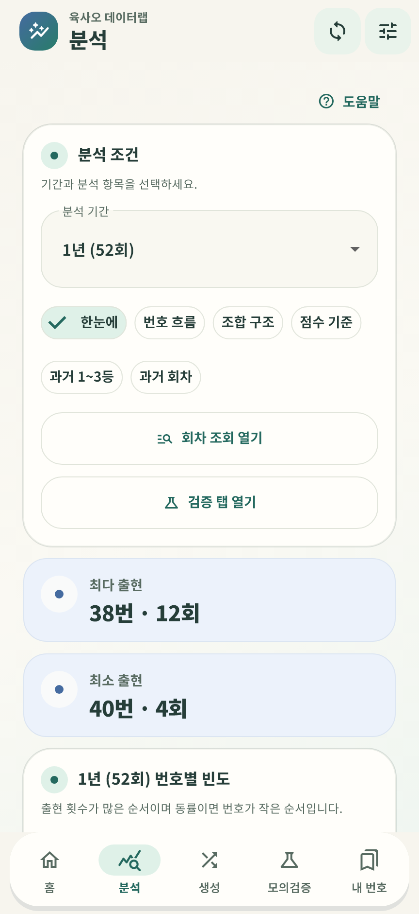 |

| 번호 생성 | 과거 모의검증 |
| --- | --- |
| 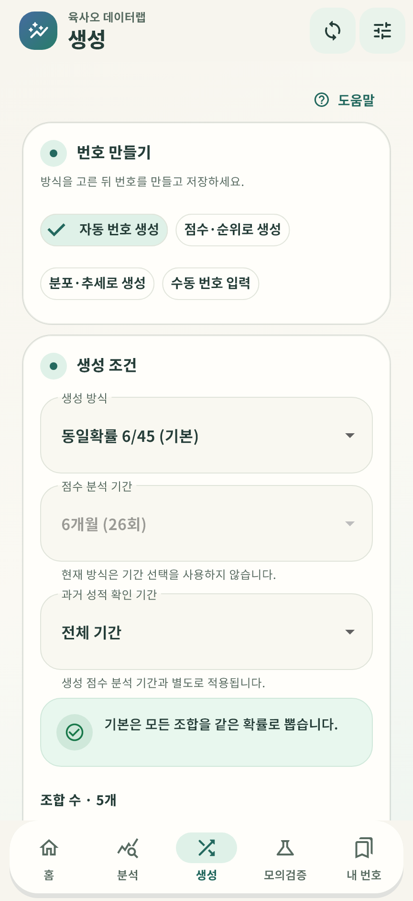 | 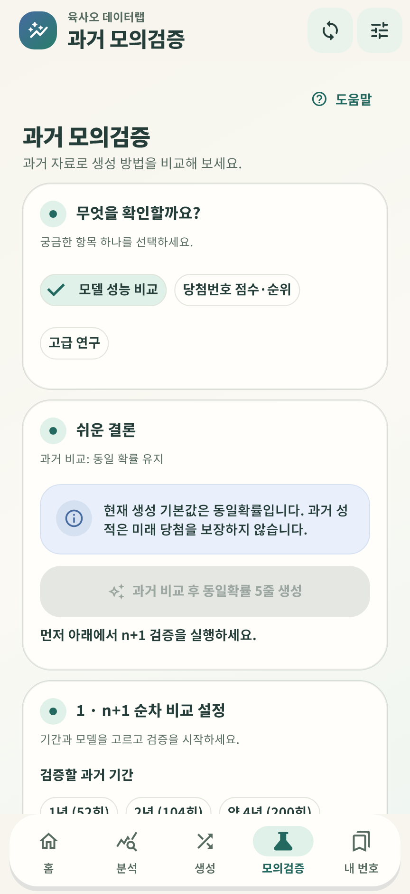 |

| 내 번호 | QR 가져오기 |
| --- | --- |
| 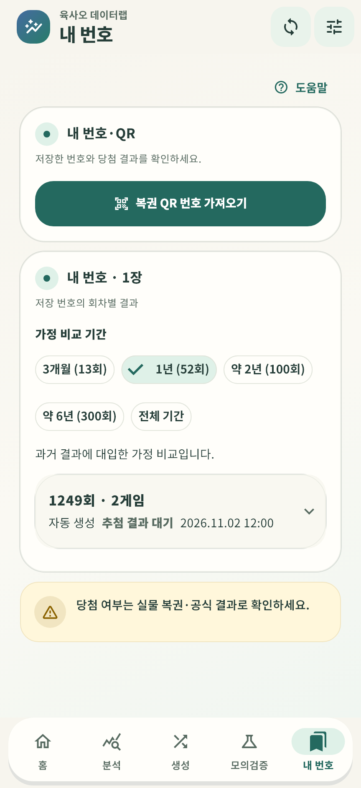 | 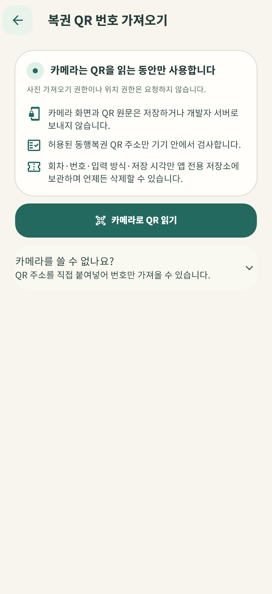 |

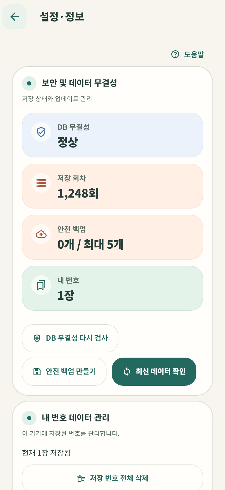
